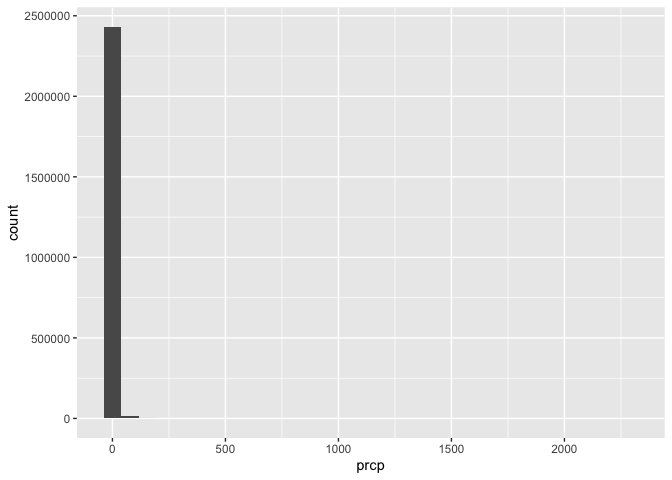
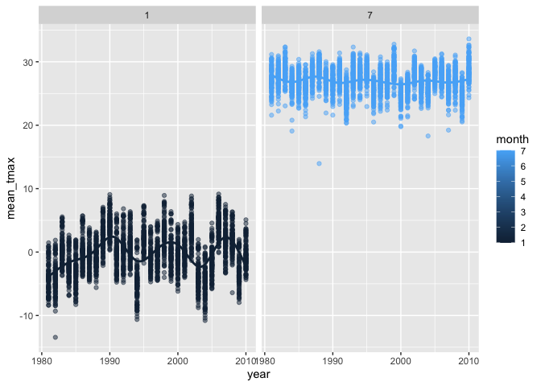
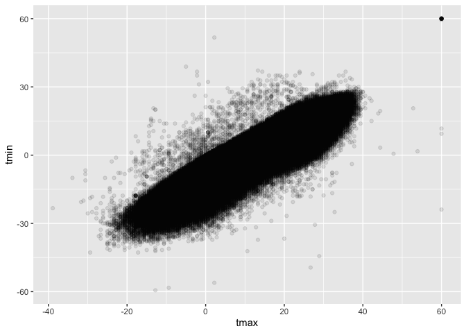
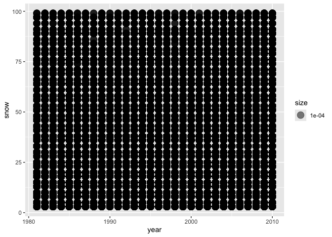

p8105_hw3_dt2833
================
Dominique Tzou
2026-10-17

# Problem 1

``` r
library(tidyverse)
```

    ## ── Attaching core tidyverse packages ──────────────────────── tidyverse 2.0.0 ──
    ## ✔ dplyr     1.2.1     ✔ readr     2.2.0
    ## ✔ forcats   1.0.1     ✔ stringr   1.6.0
    ## ✔ ggplot2   4.0.3     ✔ tibble    3.3.1
    ## ✔ lubridate 1.9.5     ✔ tidyr     1.3.2
    ## ✔ purrr     1.2.2     
    ## ── Conflicts ────────────────────────────────────────── tidyverse_conflicts() ──
    ## ✖ dplyr::filter() masks stats::filter()
    ## ✖ dplyr::lag()    masks stats::lag()
    ## ℹ Use the conflicted package (<http://conflicted.r-lib.org/>) to force all conflicts to become errors

``` r
library(dplyr)
library(lubridate)
library(p8105.datasets)
library(ggplot2)
library(patchwork)
library(ggridges)
data("ny_noaa")
```

## Description

This dataset contains New York temperature, precipitation and snow data
collected from 1981 - 2010. There are 2595176 observations and 7
variables including id, date, prcp, snow, snwd, tmax, tmin, which
describe a day’s minimum and maximum temperature, inches of
precipitation, snow and/or snow depth. However, about 44% of
observations are missing data for minimum and maximum temperature.

``` r
#creating seperate variables for date
ny_noaa  = ny_noaa |>
mutate(
    year  = year(date),
    month = month(date),
    day   = day(date),
    tmax = as.numeric(tmax), 
    tmin = as.numeric(tmin)
)

#looking at temperature, precipitation, and snowfall for reasonable units

ny_noaa_summary = 
  ny_noaa|>
summarize(
  across(prcp:tmin, 
         list(min = min, max = max, mean = mean, median=median),
         na.rm = TRUE)
  )
```

    ## Warning: There was 1 warning in `summarize()`.
    ## ℹ In argument: `across(...)`.
    ## Caused by warning:
    ## ! The `...` argument of `across()` is deprecated as of dplyr 1.1.0.
    ## Supply arguments directly to `.fns` through an anonymous function instead.
    ## 
    ##   # Previously
    ##   across(a:b, mean, na.rm = TRUE)
    ## 
    ##   # Now
    ##   across(a:b, \(x) mean(x, na.rm = TRUE))

``` r
#converting variables into reasonable units
ny_noaa = 
  ny_noaa |> 
  mutate( prcp = prcp/10,
          tmin = tmin/10, 
          tmax = tmax/10)

#checking my work 
 ny_noaa_summary = 
  ny_noaa|>
summarize(
  across(prcp:tmin, 
         list(min = min, max = max, mean = mean, median=median),
         na.rm = TRUE)
  )
         

#looking at precipitation specifically
ny_noaa |> 
  ggplot(aes(x = prcp)) + 
  geom_histogram(binwidth=500) 
```

    ## Warning: Removed 145838 rows containing non-finite outside the scale range
    ## (`stat_bin()`).

<!-- -->

``` r
#the vast majority of days have no precipitation, but there are some high precipitation days 


ny_noaa  |> 
  filter(prcp >= 1000) # there are 653 observations with over 100mm
```

    ## # A tibble: 3 × 10
    ##   id          date        prcp  snow  snwd  tmax  tmin  year month   day
    ##   <chr>       <date>     <dbl> <int> <int> <dbl> <dbl> <dbl> <dbl> <int>
    ## 1 USC00304796 1983-04-08 2032.     0     0  11.7   0.6  1983     4     8
    ## 2 USC00304844 1983-08-09 1270      0     0  22.8  15.6  1983     8     9
    ## 3 USC00306839 1982-08-20 2286      0     0  NA    NA    1982     8    20

``` r
ny_noaa |> 
 arrange(desc(prcp)) |>
head()
```

    ## # A tibble: 6 × 10
    ##   id          date        prcp  snow  snwd  tmax  tmin  year month   day
    ##   <chr>       <date>     <dbl> <int> <int> <dbl> <dbl> <dbl> <dbl> <int>
    ## 1 USC00306839 1982-08-20 2286      0     0  NA    NA    1982     8    20
    ## 2 USC00304796 1983-04-08 2032.     0     0  11.7   0.6  1983     4     8
    ## 3 USC00304844 1983-08-09 1270      0     0  22.8  15.6  1983     8     9
    ## 4 USC00306957 1983-05-21  762      0     0  20    10.6  1983     5    21
    ## 5 US1NYBM0007 2005-06-29  483.    NA    NA  NA    NA    2005     6    29
    ## 6 USC00300448 2001-03-05  279.   279   330   2.2  -9.4  2001     3     5

``` r
# there is a record on 1982-08-20 of 2286 mm precipitation, and 1983-04-08 of 2032.5 mm precipitation.  This seems unreasonable. 


#what is the most common value for snowfall
ny_noaa  |>
  count(snow, name = "n_obs")
```

    ## # A tibble: 282 × 2
    ##     snow   n_obs
    ##    <int>   <int>
    ##  1   -13       1
    ##  2     0 2008508
    ##  3     3    8790
    ##  4     5    9748
    ##  5     8    9962
    ##  6    10    5106
    ##  7    13   23095
    ##  8    15    3672
    ##  9    18    3226
    ## 10    20    4797
    ## # ℹ 272 more rows

Ensure observations for temperature, precipitation, and snowfall are
given in reasonable units. For snowfall, what are the most commonly
observed values? Why?

Response: Given the summary values of the variables and geography
climate of new york, I infer that the variables are initially reported
in the following units. prcp: 0.1mm (mean= 29.8, max = 22860) snow fall:
mm (mean = 4.98, max = 10160) snow depth: mm (mean = 37.3, max = 9195)
temperature min: 0.1 Celcius (median = 33) temperature max: 0.1 Celcius
(median = 150)

I have adjusted them to be more interpretable and standardized. prcp: mm
snow fall: mm (no change) snow depth: mm (no change) temperature min:
Celcius temperature max: Celcius

There are some unreasonable values, such as highest value of
precipitation of 2286mm, and smallest value of snowfall of -13 mm. The
tmin min and tmax max is 60 C, which seems unreasonable, inidicating the
reporting thermometer was broken, as they were both reported from the
same location ID: USR0000NGAN and span of time 08-17-2008 through
09-16-2008.

The most commonly observed values for snowfall are 0, 3, 5 and 8

## Plots

Make a two-panel plot showing the average max temperature in January and
in July in each station across years. Is there any observable /
interpretable structure? Any outliers? For July, it is relatively more
stable and less variability than in January, where the ranges are wider.
For July, the average hovers around 27 C, while in January, it flucuates
around 0 C. There are outliers. For January, there was a cold day with a
mean_tmax of approx -14C around 1982. For July, there is an outlier
around 1988 of a mean_tmax of 14C.

\#Q:what is on the x axis, years???

``` r
ny_noaa  |>
  filter(month %in% c(1, 7)) |>
  group_by(id, year, month) |>
  summarize(
    mean_tmax = mean(tmax)
  )|>
  ggplot(aes(x = year, y = mean_tmax,color = month)) + 
  geom_point(alpha = .5) +
  geom_smooth(se = FALSE) + 
  facet_grid(.~month)
```

    ## `summarise()` has regrouped the output.
    ## `geom_smooth()` using method = 'gam' and formula = 'y ~ s(x, bs = "cs")'
    ## ℹ Summaries were computed grouped by id, year, and month.
    ## ℹ Output is grouped by id and year.
    ## ℹ Use `summarise(.groups = "drop_last")` to silence this message.
    ## ℹ Use `summarise(.by = c(id, year, month))` for per-operation grouping
    ##   (`?dplyr::dplyr_by`) instead.

    ## Warning: Removed 7058 rows containing non-finite outside the scale range
    ## (`stat_smooth()`).

    ## Warning: Removed 7058 rows containing missing values or values outside the scale range
    ## (`geom_point()`).

<!-- -->

Two-panel plot (histogram) showing (i) tmax vs tmin for the full dataset

``` r
tmax_histo =
ny_noaa  |>
  ggplot(aes(x =tmax)) + 
  geom_histogram()

tmin_histo =
ny_noaa  |>
  ggplot(aes(x =tmin)) + 
  geom_histogram()

(tmax_histo+tmin_histo) #two panel-plot
```

    ## `stat_bin()` using `bins = 30`. Pick better value `binwidth`.

    ## Warning: Removed 1134358 rows containing non-finite outside the scale range
    ## (`stat_bin()`).

    ## `stat_bin()` using `bins = 30`. Pick better value `binwidth`.

    ## Warning: Removed 1134420 rows containing non-finite outside the scale range
    ## (`stat_bin()`).

<!-- -->

2)  a plot showing the distribution of snowfall values greater than 0
    and less than 100 separately by year.

``` r
ny_noaa  |>
  mutate(year = as.character(year)) |>
  filter( 0 <snow & 100> snow ) |>
  ggplot(aes(x = snow)) + 
     geom_density(aes(fill = year), alpha = .5) +
facet_wrap(~year) 
```

<!-- -->

``` r
ny_noaa  |>
  mutate(year = as.character(year)) |>
  filter( 0 <snow & 100> snow ) |>
  ggplot(aes(x = snow)) + 
     geom_boxplot()  + 
facet_wrap(~year) 
```

<!-- -->

``` r
#not working 
ny_noaa  |>
  filter( 0 <snow & 100> snow ) |>
  ggplot(aes(x=year, y = snow)) + 
     geom_point(aes(size = .0001),alpha = .5)
```

<!-- -->
