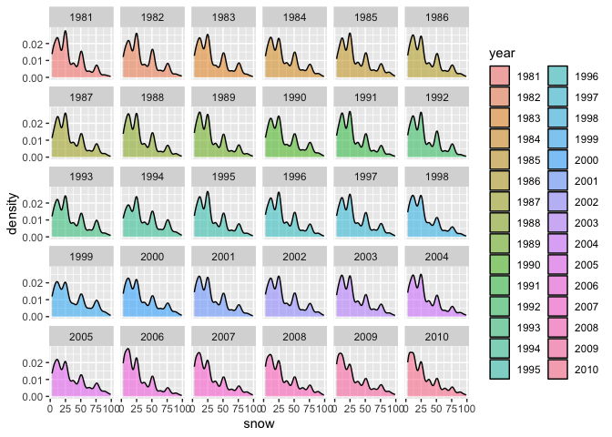
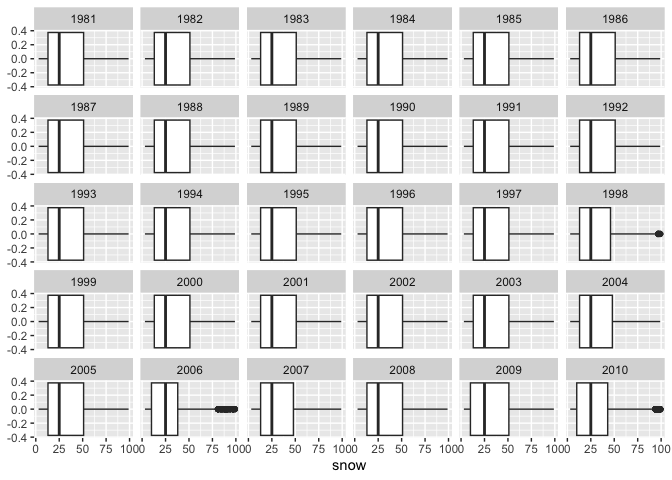
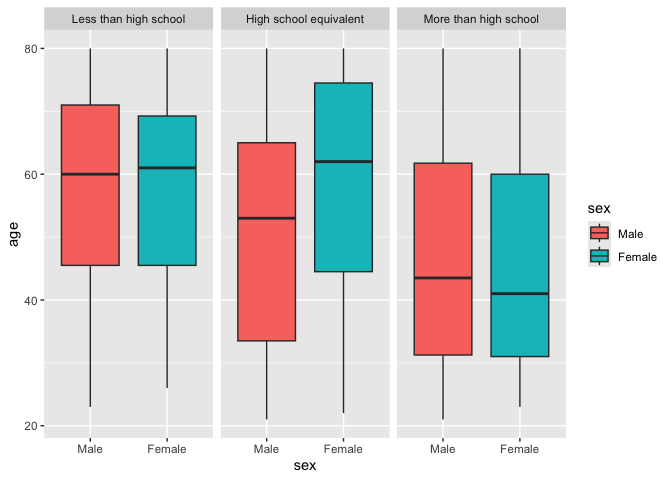
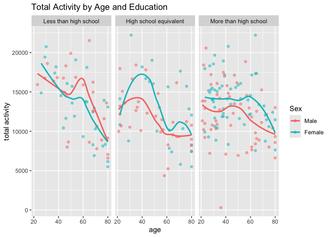
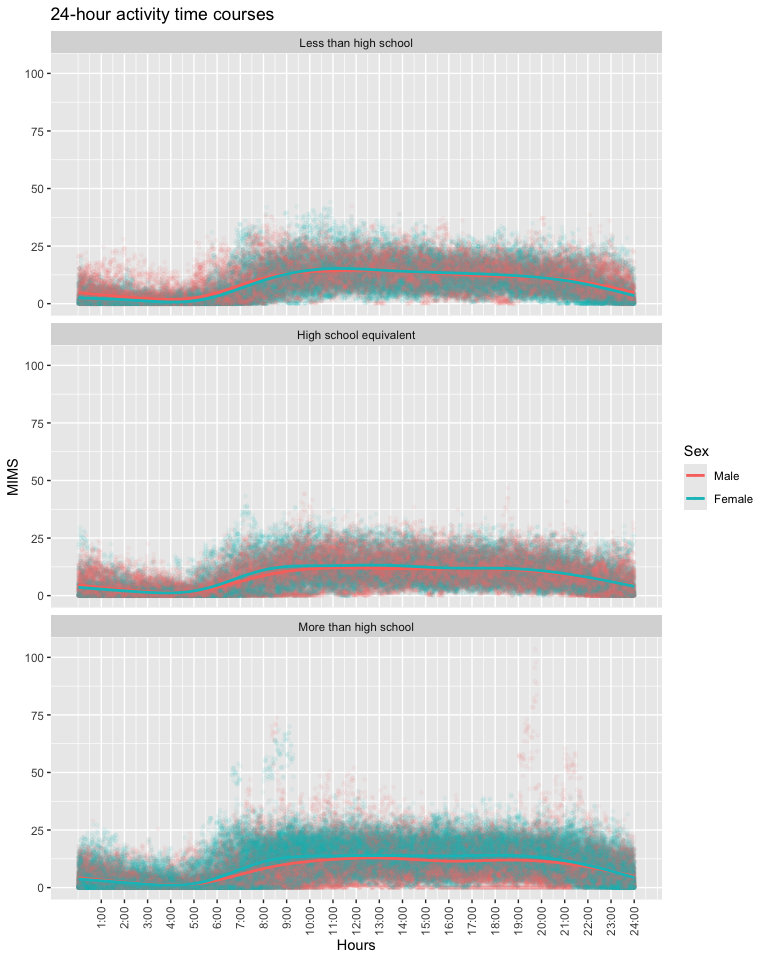
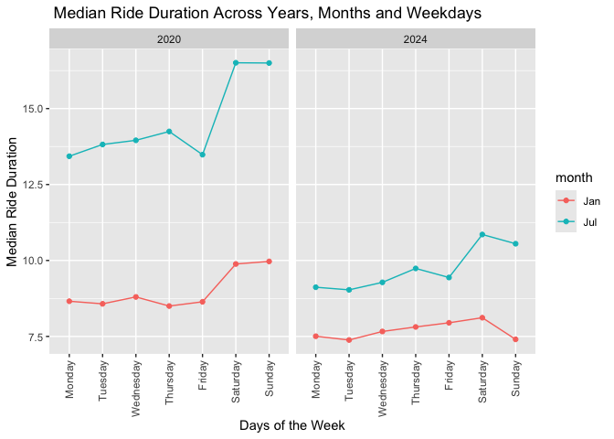
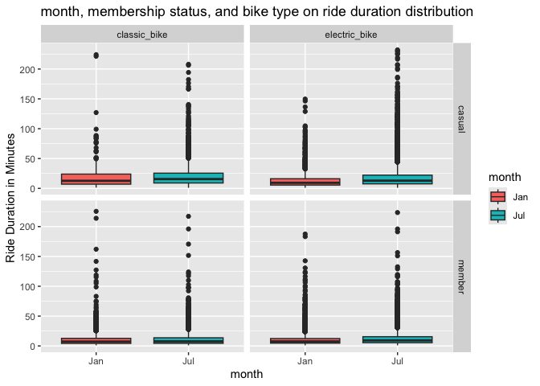

p8105_hw3_dt2833
================
Dominique Tzou
2026-10-17

# Problem 1

``` r
library(tidyverse)
```

    ## ── Attaching core tidyverse packages ──────────────────────── tidyverse 2.0.0 ──
    ## ✔ dplyr     1.2.1     ✔ readr     2.2.0
    ## ✔ forcats   1.0.1     ✔ stringr   1.6.0
    ## ✔ ggplot2   4.0.3     ✔ tibble    3.3.1
    ## ✔ lubridate 1.9.5     ✔ tidyr     1.3.2
    ## ✔ purrr     1.2.2     
    ## ── Conflicts ────────────────────────────────────────── tidyverse_conflicts() ──
    ## ✖ dplyr::filter() masks stats::filter()
    ## ✖ dplyr::lag()    masks stats::lag()
    ## ℹ Use the conflicted package (<http://conflicted.r-lib.org/>) to force all conflicts to become errors

``` r
library(dplyr)
library(lubridate)
library(p8105.datasets)
library(ggplot2)
library(patchwork)
library(ggridges)
data("ny_noaa")
```

## Description

This dataset contains New York temperature, precipitation and snow data
collected from 1981 - 2010. There are 2595176 observations and 7
variables including id, date, prcp, snow, snwd, tmax, tmin, which
describe a day’s minimum and maximum temperature, inches of
precipitation, snow and/or snow depth. However, about 44% of
observations are missing data for minimum and maximum temperature.

``` r
#creating seperate variables for date
ny_noaa  = ny_noaa |>
janitor::clean_names() |>
mutate(
    year  = year(date),
    month = month(date),
    day   = day(date),
    tmax = as.numeric(tmax), 
    tmin = as.numeric(tmin)
)

#looking at temperature, precipitation, and snowfall for reasonable units

noaa_mean= 
  ny_noaa|>
   summarize(across(tmin:prcp, mean, na.rm = TRUE))
```

    ## Warning: There was 1 warning in `summarize()`.
    ## ℹ In argument: `across(tmin:prcp, mean, na.rm = TRUE)`.
    ## Caused by warning:
    ## ! The `...` argument of `across()` is deprecated as of dplyr 1.1.0.
    ## Supply arguments directly to `.fns` through an anonymous function instead.
    ## 
    ##   # Previously
    ##   across(a:b, mean, na.rm = TRUE)
    ## 
    ##   # Now
    ##   across(a:b, \(x) mean(x, na.rm = TRUE))

``` r
noaa_median=   
 ny_noaa|>
   summarize(across(tmin:prcp, median, na.rm = TRUE))

noaa_min=   
 ny_noaa|>
   summarize(across(tmin:prcp, min,na.rm = TRUE))
 
noaa_max=  
 ny_noaa|>
   summarize(across(tmin:prcp, max,na.rm = TRUE))

noaa_mean
```

    ## # A tibble: 1 × 5
    ##    tmin  tmax  snwd  snow  prcp
    ##   <dbl> <dbl> <dbl> <dbl> <dbl>
    ## 1  30.3  140.  37.3  4.99  29.8

``` r
noaa_median
```

    ## # A tibble: 1 × 5
    ##    tmin  tmax  snwd  snow  prcp
    ##   <dbl> <dbl> <dbl> <int> <dbl>
    ## 1    33   150     0     0     0

``` r
noaa_min
```

    ## # A tibble: 1 × 5
    ##    tmin  tmax  snwd  snow  prcp
    ##   <dbl> <dbl> <int> <int> <int>
    ## 1  -594  -389     0   -13     0

``` r
noaa_max
```

    ## # A tibble: 1 × 5
    ##    tmin  tmax  snwd  snow  prcp
    ##   <dbl> <dbl> <int> <int> <int>
    ## 1   600   600  9195 10160 22860

``` r
#converting variables into reasonable units
ny_noaa = 
  ny_noaa |> 
  mutate( prcp = prcp/10,
          tmin = tmin/10, 
          tmax = tmax/10)

#checking my work 
noaa_mean= 
  ny_noaa|>
   summarize(across(tmin:prcp,mean, na.rm = TRUE))

noaa_median=   
 ny_noaa|>
   summarize(across(tmin:prcp, median, na.rm = TRUE))

noaa_min=   
 ny_noaa|>
   summarize(across(tmin:prcp, min,na.rm = TRUE))
 
noaa_max=  
 ny_noaa|>
   summarize(across(tmin:prcp, max,na.rm = TRUE))

noaa_mean
```

    ## # A tibble: 1 × 5
    ##    tmin  tmax  snwd  snow  prcp
    ##   <dbl> <dbl> <dbl> <dbl> <dbl>
    ## 1  3.03  14.0  37.3  4.99  2.98

``` r
noaa_median
```

    ## # A tibble: 1 × 5
    ##    tmin  tmax  snwd  snow  prcp
    ##   <dbl> <dbl> <dbl> <int> <dbl>
    ## 1   3.3    15     0     0     0

``` r
noaa_min
```

    ## # A tibble: 1 × 5
    ##    tmin  tmax  snwd  snow  prcp
    ##   <dbl> <dbl> <int> <int> <dbl>
    ## 1 -59.4 -38.9     0   -13     0

``` r
noaa_max
```

    ## # A tibble: 1 × 5
    ##    tmin  tmax  snwd  snow  prcp
    ##   <dbl> <dbl> <int> <int> <dbl>
    ## 1    60    60  9195 10160  2286

Exploring data, looking at precipitation specifically

``` r
ny_noaa |> 
  ggplot(aes(x = prcp)) + 
  geom_histogram()
```

    ## `stat_bin()` using `bins = 30`. Pick better value `binwidth`.

    ## Warning: Removed 145838 rows containing non-finite outside the scale range
    ## (`stat_bin()`).

<!-- -->

``` r
#the vast majority of days have no precipitation, but there are some high precipitation days 


ny_noaa  |> 
  filter(prcp >= 1000) # there are 653 observations with over 100mm
```

    ## # A tibble: 3 × 10
    ##   id          date        prcp  snow  snwd  tmax  tmin  year month   day
    ##   <chr>       <date>     <dbl> <int> <int> <dbl> <dbl> <dbl> <dbl> <int>
    ## 1 USC00304796 1983-04-08 2032.     0     0  11.7   0.6  1983     4     8
    ## 2 USC00304844 1983-08-09 1270      0     0  22.8  15.6  1983     8     9
    ## 3 USC00306839 1982-08-20 2286      0     0  NA    NA    1982     8    20

``` r
ny_noaa |> 
 arrange(desc(prcp)) |>
head()
```

    ## # A tibble: 6 × 10
    ##   id          date        prcp  snow  snwd  tmax  tmin  year month   day
    ##   <chr>       <date>     <dbl> <int> <int> <dbl> <dbl> <dbl> <dbl> <int>
    ## 1 USC00306839 1982-08-20 2286      0     0  NA    NA    1982     8    20
    ## 2 USC00304796 1983-04-08 2032.     0     0  11.7   0.6  1983     4     8
    ## 3 USC00304844 1983-08-09 1270      0     0  22.8  15.6  1983     8     9
    ## 4 USC00306957 1983-05-21  762      0     0  20    10.6  1983     5    21
    ## 5 US1NYBM0007 2005-06-29  483.    NA    NA  NA    NA    2005     6    29
    ## 6 USC00300448 2001-03-05  279.   279   330   2.2  -9.4  2001     3     5

``` r
# there is a record on 1982-08-20 of 2286 mm precipitation, and 1983-04-08 of 2032.5 mm precipitation.  This seems unreasonable. 


#what is the most common value for snowfall
ny_noaa  |>
  count(snow, name = "n_obs", sort = TRUE)
```

    ## # A tibble: 282 × 2
    ##     snow   n_obs
    ##    <int>   <int>
    ##  1     0 2008508
    ##  2    NA  381221
    ##  3    25   31022
    ##  4    13   23095
    ##  5    51   18274
    ##  6    76   10173
    ##  7     8    9962
    ##  8     5    9748
    ##  9    38    9197
    ## 10     3    8790
    ## # ℹ 272 more rows

**Observations and Adjustments** Given the summary values of the
variables and geography climate of new york, I infer that the variables
are initially reported in the following units.

prcp: 0.1mm (mean= 29.8, max = 22860)

snow fall: mm (mean = 4.98, max = 10160)

snow depth: mm (mean = 37.3, max = 9195)

temperature min: 0.1 Celcius (median = 33)

temperature max: 0.1 Celcius (median = 150)

I have adjusted them to be more interpretable and standardized.

prcp: mm

snow fall: mm (no change)

snow depth: mm (no change)

temperature min: Celcius

temperature max: Celcius

There are some unreasonable values, such as highest value of
precipitation of 2286mm, and smallest value of snowfall of -13 mm. The
tmin min and tmax max is 60 C, which seems unreasonable, indicating the
reporting thermometer was broken, as they were both reported from the
same location ID: USR0000NGAN and span of time 08-17-2008 through
09-16-2008.

The most commonly (non missing) observed values for snowfall are 0mm,
25mm, 13mm, and 51mm, and 76mm)

### Plots

For July, it is relatively more stable and less variability than in
January, where the ranges are wider. For July, the average hovers around
27 C, while in January, it fluctuates around 0 C. There are outliers.
For January, there was a cold day with a mean_tmax of approx -14C around
1982. For July, there is an outlier around 1988 of a mean_tmax of 14C.

``` r
ny_noaa  |>
  filter(month %in% c(1, 7)) |>
  group_by(id, year, month) |>
  summarize(
    mean_tmax = mean(tmax)
  )|>
  ggplot(aes(x = year, y = mean_tmax,color = month)) + 
  geom_point(alpha = .5) +
  geom_smooth(se = FALSE) + 
  facet_grid(.~month)
```

    ## `summarise()` has regrouped the output.
    ## `geom_smooth()` using method = 'gam' and formula = 'y ~ s(x, bs = "cs")'
    ## ℹ Summaries were computed grouped by id, year, and month.
    ## ℹ Output is grouped by id and year.
    ## ℹ Use `summarise(.groups = "drop_last")` to silence this message.
    ## ℹ Use `summarise(.by = c(id, year, month))` for per-operation grouping
    ##   (`?dplyr::dplyr_by`) instead.

    ## Warning: Removed 7058 rows containing non-finite outside the scale range
    ## (`stat_smooth()`).

    ## Warning: Removed 7058 rows containing missing values or values outside the scale range
    ## (`geom_point()`).

<!-- -->

Two-panel plot (histogram) showing (i) tmax vs tmin for the full dataset

``` r
ny_noaa  |>
  ggplot(aes(x =tmax, y=tmin)) + 
  geom_point(alpha = .1)
```

    ## Warning: Removed 1136276 rows containing missing values or values outside the scale
    ## range (`geom_point()`).

<!-- -->

2)  a plot showing the distribution of snowfall values greater than 0
    and less than 100 separately by year.

``` r
#density plot for each year
ny_noaa  |>
  mutate(year = as.character(year)) |>
  filter( 0 <snow & 100> snow ) |>
  ggplot(aes(x = snow)) + 
     geom_density(aes(fill = year), alpha = .5) +
facet_wrap(~year) 
```

<!-- -->

``` r
#box plot for each year
ny_noaa  |>
  mutate(year = as.character(year)) |>
  filter( 0 <snow & 100> snow ) |>
  ggplot(aes(x = snow)) + 
     geom_boxplot()  + 
facet_wrap(~year) 
```

<!-- -->

# Problem 2

``` r
#importing
accel_df = read_csv(file = "./data/nhanes_accel.csv", 
                      na = c("NA", ".", ""))|>
          janitor::clean_names() 
```

    ## Rows: 250 Columns: 1441
    ## ── Column specification ────────────────────────────────────────────────────────
    ## Delimiter: ","
    ## dbl (1441): SEQN, min1, min2, min3, min4, min5, min6, min7, min8, min9, min1...
    ## 
    ## ℹ Use `spec()` to retrieve the full column specification for this data.
    ## ℹ Specify the column types or set `show_col_types = FALSE` to quiet this message.

``` r
covar_df = read_csv(file = "./data/nhanes_covar.csv" , na = c("NA", ".", ""), skip =4)|>
janitor::clean_names() |>
  drop_na()|>
  filter(age >=21) |>
  mutate( #encoding sex and education as factor variable as they are categories
    sex = as.factor(sex), 
    sex = recode(sex, 
                         `1` = "Male", 
                         `2` = "Female"),
    education = as.factor(education),
    education = recode(education, 
                         `1` = "Less than high school", 
                         `2` = "High school equivalent",
                        `3` = "More than high school")
  )
```

    ## Rows: 250 Columns: 5
    ## ── Column specification ────────────────────────────────────────────────────────
    ## Delimiter: ","
    ## dbl (5): SEQN, sex, age, BMI, education
    ## 
    ## ℹ Use `spec()` to retrieve the full column specification for this data.
    ## ℹ Specify the column types or set `show_col_types = FALSE` to quiet this message.

``` r
#merging 

nhanes_df = 
  left_join(covar_df, accel_df, by = "seqn")
```

### Distribution of Sex Among Education Level of Study Participants

``` r
#table
nhanes_df |> 
  group_by(education, sex) |> 
janitor::tabyl(education, sex) |>
  knitr::kable(
    col.names = c("Education Level", "Male", "Female")
  )
```

| Education Level        | Male | Female |
|:-----------------------|-----:|-------:|
| Less than high school  |   27 |     28 |
| High school equivalent |   35 |     23 |
| More than high school  |   56 |     59 |

``` r
#bar graph
nhanes_df |>
  ggplot(aes(x = education, fill = sex)) + 
  geom_bar(position = "dodge")+
  geom_text(stat = "count", aes(label = after_stat(count)),position = position_dodge(width = 0.9), vjust = -0.5) +
  labs(title = "Distribution of Sex Among Edcuation Level of Study Participants", x = "Education Level", y = "Number of Participants")
```

<!-- -->

``` r
nhanes_df |> 
  ggplot(aes(x = sex, y = age, fill = sex))+ 
  geom_boxplot() +
  facet_wrap(~education) 
```

<!-- -->

The boxplot comparisions of age distribution by sex and education level
show that among “less than high school” and “more than high school”
groups, age distribution between males and females are relatively
similar. “Less than highschool” ranges and medians are higher than “More
than high school.” This is also true for subject counts, as females and
males contribute similarly, in both “Less than high school” (27 Male ,
28 Female) and “More than Highschool” (Male= 56, Female = 59). “More
than High school” is the education level with the most participants.

For the “High school equivalent” group, males’ median and interquartile
range of age is lower than of females’. In this group, the females’ 75th
percentile of age is the oldest among education levels. Subject count
distribution is also nonequivalent by sex, with 35 Males and 23 Females.

### Total Activity by Age and Education

``` r
# creating variable for total activity variable for each participant
nhanes_df =
  nhanes_df |> 
  mutate( 
    total_time = rowSums(across(min1:min1440),na.rm = TRUE) 
    )

# plot total time
nhanes_df |>
 ggplot(aes(x = age, y = total_time)) + 
  geom_point(aes(color = sex),alpha = .5) +
  geom_smooth(aes(color = sex),se = FALSE) + 
  labs(
    title = "Total Activity by Age and Education",
    y = "total activity",
    color = "Sex")+
  facet_grid(.~education)
```

    ## `geom_smooth()` using method = 'loess' and formula = 'y ~ x'

<!-- -->

Between males and female, the largest difference is among high school
equivalent education level, where females have higher total activity at
younger ages, compared to males. High school equivalent education level
has a total activity peak around age 40, and then total activity
decreases with age.

Less than high school has the most distinct sharpest downward trend,
where total activity time decreases with age and sex is similar. There
is spike in total activity at 60.

Among more than highschool, there is a platued trend around 13000 total
activity time until 55, where total activity time decreases with
age.Here Female activity is consistently higher than males.

Around age 60, activity trends change across sex and education level.
Among less than high school, activity begins a steep decrease. Among
high school equivalent, activity platues for males and increases and
then decreases for females. Among more than high school, activity begins
to decrease.

### 24-hour activity

``` r
#plot 24-hour activity
nhanes_df_pivot = 
 nhanes_df |>
  pivot_longer(
    min1:min1440,
    names_to = "min",
    values_to = "mims" ) |>
   separate(min, into = c("mins", "mins_time"), sep = 3) |>
  select (-mins)|>
  mutate ( mins_time = as.numeric(mins_time))

nhanes_df_pivot |>
  ggplot(aes(x = mins_time, y =mims)) + 
  geom_point(aes(color = factor(sex)), size = 1, alpha = .05) + 
  geom_smooth(aes(color = sex),se = FALSE) + 
 labs(
    title = "24-hour activity time courses",
    x = "Hours",
    y = "MIMS",
    color = "Sex") + 
  scale_x_continuous(
    breaks = c(60, 120, 180, 240, 300, 360, 420, 480, 540, 600, 660, 720, 780, 840, 900, 960, 1020, 1080, 1140, 1200, 1260, 1320, 1380, 1440), 
    labels = c("1:00", "2:00", "3:00", "4:00","5:00", "6:00", "7:00", "8:00","9:00","10:00", "11:00", "12:00",
               "13:00", "14:00", "15:00", "16:00","17:00", "18:00", "19:00", "20:00","21:00","22:00", "23:00", "24:00"))+ 
  theme(axis.text.x = element_text(angle = 90, vjust = 0.5, hjust = 1))+
  facet_wrap(~education, ncol = 1)
```

    ## `geom_smooth()` using method = 'gam' and formula = 'y ~ s(x, bs = "cs")'

<!-- -->

Overall the activity trends are similar between sex and between
education level. Activity is low between 1am - 5am( sleeping), and it
consistent around 12 MIMS until it starts decreasing 9pm. Among more
than high school , we see more outliers compared to other education
levels. There are higher amounts of MIMs among females around 8-9:00am,
while higher amounts of MIMs around 8-10pm, before and after a typical
work day. Among more than high school, females’ MIMs tend to trend
higher than males’. Among the other educational levels, there is not a
distinguishable trend between sex.

# Problem 3

Importing Data

``` r
citijan2020_df = read_csv(file = "./data/Jan 2020 Citi.csv", 
                      na = c("NA", ".", ""))|>
          janitor::clean_names() |> 
          mutate(year = 2020, month = "Jan")
```

    ## Rows: 12420 Columns: 7
    ## ── Column specification ────────────────────────────────────────────────────────
    ## Delimiter: ","
    ## chr (6): ride_id, rideable_type, weekdays, start_station_name, end_station_n...
    ## dbl (1): duration
    ## 
    ## ℹ Use `spec()` to retrieve the full column specification for this data.
    ## ℹ Specify the column types or set `show_col_types = FALSE` to quiet this message.

``` r
citijuly2020_df = read_csv(file = "./data/July 2020 Citi.csv", 
                      na = c("NA", ".", ""))|>
          janitor::clean_names() |> 
          mutate(year = 2020, month = "Jul")
```

    ## Rows: 21048 Columns: 7
    ## ── Column specification ────────────────────────────────────────────────────────
    ## Delimiter: ","
    ## chr (6): ride_id, rideable_type, weekdays, start_station_name, end_station_n...
    ## dbl (1): duration
    ## 
    ## ℹ Use `spec()` to retrieve the full column specification for this data.
    ## ℹ Specify the column types or set `show_col_types = FALSE` to quiet this message.

``` r
citijan2024_df = read_csv(file = "./data/Jan 2024 Citi.csv", 
                      na = c("NA", ".", ""))|>
          janitor::clean_names() |> 
          mutate(year = 2024, month = "Jan")
```

    ## Rows: 18861 Columns: 7
    ## ── Column specification ────────────────────────────────────────────────────────
    ## Delimiter: ","
    ## chr (6): ride_id, rideable_type, weekdays, start_station_name, end_station_n...
    ## dbl (1): duration
    ## 
    ## ℹ Use `spec()` to retrieve the full column specification for this data.
    ## ℹ Specify the column types or set `show_col_types = FALSE` to quiet this message.

``` r
citijuly2024_df = read_csv(file = "./data/July 2024 Citi.csv", 
                      na = c("NA", ".", ""))|>
          janitor::clean_names() |> 
          mutate(year = 2024, month ="Jul")
```

    ## Rows: 47156 Columns: 7
    ## ── Column specification ────────────────────────────────────────────────────────
    ## Delimiter: ","
    ## chr (6): ride_id, rideable_type, weekdays, start_station_name, end_station_n...
    ## dbl (1): duration
    ## 
    ## ℹ Use `spec()` to retrieve the full column specification for this data.
    ## ℹ Specify the column types or set `show_col_types = FALSE` to quiet this message.

``` r
citi_df = 
  bind_rows(citijan2020_df,citijuly2020_df, citijan2024_df, citijuly2024_df) |>
  janitor::clean_names()
```

**Description**

This dataset describes citi bike rides from Jan & July 2020 and Jan &
July 2024. With the 4 datasets combined there is a total of 99485
observations, with 9 variables including ride_id, rideable_type,
weekdays, duration, start_station_name, end_station_name, member_casual,
year, month.

``` r
citi_df |> 
  group_by(year, month, member_casual) |> 
    count(member_casual, year, month) %>%
  pivot_wider(
    names_from = c(year, month), 
    values_from = n, 
    values_fill = 0
  )|>
   knitr::kable(
    col.names = c("Membership Status", "Jan 2020", "Jul 2020", "Jan 2024", "Jul 2024")
  )
```

| Membership Status | Jan 2020 | Jul 2020 | Jan 2024 | Jul 2024 |
|:------------------|---------:|---------:|---------:|---------:|
| casual            |      984 |     5637 |     2108 |    10894 |
| member            |    11436 |    15411 |    16753 |    36262 |

Between membership status, members consistently had more rides than
casual riders. Between months, July had more rides than January, in
every comparision, when matched for year and membership. Between years,
2024 had more rides than 2020, when matched for month and membership.

The 5 most popular starting stations for July 2024; including the number
of rides originating from these stations.

``` r
citijuly2024_df |> 
  count(start_station_name,name = "n_rides", sort = TRUE)|> 
  head(n=5)|>
   knitr::kable(
    col.names = c("Start Station Name", "Number of Rides")
  )
```

| Start Station Name       | Number of Rides |
|:-------------------------|----------------:|
| Pier 61 at Chelsea Piers |             163 |
| University Pl & E 14 St  |             155 |
| W 21 St & 6 Ave          |             152 |
| West St & Chambers St    |             150 |
| W 31 St & 7 Ave          |             146 |

**Median Ride Duration Across Years, Months and Weekdays**

``` r
week_order = c("Monday", "Tuesday", "Wednesday", "Thursday", "Friday", "Saturday", "Sunday")

citi_df |>
  mutate(weekdays= factor(weekdays, levels = week_order))|>
  group_by(year, month, weekdays) |> 
  summarize(median =median(duration, na.rm = TRUE)) |>
  ggplot(aes(x= weekdays, y = median, color=month, group = month))+
  geom_point()+
  geom_line()+ facet_grid(.~year)+
  theme(axis.text.x = element_text(angle = 90, vjust = 0.5, hjust = 1))+
  labs(
    title = " Median Ride Duration Across Years, Months and Weekdays",
    x = "Days of the Week",
    y = "Median Ride Duration")
```

    ## `summarise()` has regrouped the output.
    ## ℹ Summaries were computed grouped by year, month, and weekdays.
    ## ℹ Output is grouped by year and month.
    ## ℹ Use `summarise(.groups = "drop_last")` to silence this message.
    ## ℹ Use `summarise(.by = c(year, month, weekdays))` for per-operation grouping
    ##   (`?dplyr::dplyr_by`) instead.

<!-- -->

Comparing months between years, 2020 had longer median ride duration
than 2024 and a bigger difference between January and July. Overall,
median ride duration increased over the week, peaking on saturday.

**Impact of month, membership status, and bike type on the distribution
of ride duration**

``` r
citi_2024_df = 
citi_df |> 
filter(year == 2024) |> #selecting for 2024 only 
  mutate(month= factor(month)) # for using boxplot

citi_2024_df |> 
  ggplot(aes(x =month, y = duration, fill = month)) + 
    geom_boxplot()+
  labs(
    title = "month, membership status, and bike type on ride duration distribution",y = "Ride Duration in Minutes")+facet_grid(member_casual~rideable_type)
```

<!-- -->

Between months of January and July, ride duration is relatively similar,
when compared among bike type and membership status. The largest IQR of
ride durations is among casual riders using classic bikes. For member
rides, the 75% of rides are short, less than ~20 minutes, thus, casual
riders had longer ride durations overall(75% under ~25 minutes).For
members, classic bike and electric bike durations are similar, across
January and July too. There is a large spread of ride duration outliers
among casual electric bike rides in July.
